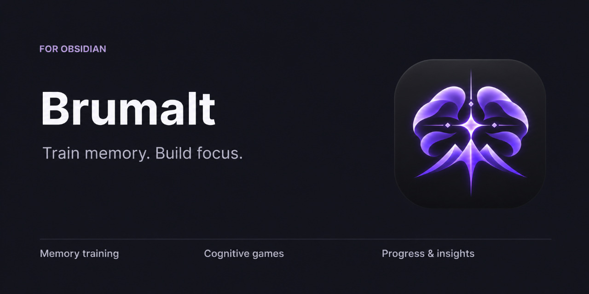

# Brumalt

Brumalt is a free, offline Obsidian plugin with quick memory and logic games, adaptive difficulty, gentle daily goals, and personal progress tracking.

**[Русский](README.ru.md)** · [Download 0.3.5](https://github.com/zinverno/brumalt/releases/tag/0.3.5) · MIT · by **Zinvernix**

- Six games in one small window over your current note.
- Approximate 1 / 3 / 5 minute sessions, or a single game of your choice.
- Separate difficulty per game, local results and an exercise-profile chart.
- Optional daily points and reminders, without streak penalties or locked content.
- English and Russian. No accounts, ads, telemetry, network requests or access to note contents.

Brumalt is for intellectual recreation and practice in these particular exercises. It is not a validated IQ test and makes no claim to scientifically proven gains in general intelligence.

## Installation

Start in a disposable test vault. Requires Obsidian **1.13.0+** for searchable declarative settings. Brumalt 0.3.3 retains its original compatibility entry. This public beta has automated coverage; native/mobile and visual acceptance limits are listed in [VALIDATION](docs/VALIDATION.md).

1. Download `brumalt-0.3.5.zip` from the [GitHub Release](https://github.com/zinverno/brumalt/releases/tag/0.3.5).
2. Extract the single `brumalt` folder into `<vault>/.obsidian/plugins/` (or your vault's custom configuration directory).
3. Check that `main.js`, `manifest.json`, `styles.css` and `LICENSE` are directly inside `brumalt/`.
4. Enable community plugins, then **Brumalt**, in Obsidian's settings.

The release also provides `main.js`, `manifest.json` and `styles.css` separately. `SHA256SUMS` verifies the ZIP and the installation files after extracting it. The plugin has not been submitted to the Obsidian Community Directory.

For future Brumalt updates, **back up and preserve `brumalt/data.json`** and replace only installation files. Do not delete the plugin folder. Installation packages never contain user data.

### Upgrading from Casual Memory Games

The plugin ID changes from `casual-memory-games` to **`brumalt`**. Use this order:

1. Back up the old `<config>/plugins/casual-memory-games/data.json` outside both plugin folders.
2. **Disable Casual Memory Games.** Do not run both plugins together.
3. Install Brumalt into its new `brumalt` folder, then enable it.
4. If `brumalt/data.json` is **absent** and the old file exists, Brumalt validates and automatically imports it once, before games or reminders start. A notice confirms success.
5. Check your settings, levels, history and daily activity. Only then decide whether to keep the disabled old folder as a backup. Brumalt never deletes or modifies it.

The importer uses Obsidian's public vault adapter plus `loadData` / `saveData` and respects a custom configuration directory. Schemas from 0.1.0 through 0.3.2 are accepted; older schema migrations are validated. Already-current schema 4 is preserved. Import copies existing results, not new attempts: it does not reapply adaptation or award points again. Restarting reads the new file without reimporting.

**An existing new file always wins**, even if empty or corrupt. Old and new histories are never merged. Invalid source data, a read error or failed import blocks games and writes instead of silently starting over. The old file stays untouched. If an import failed before creating a new file, fix the disk problem and reload to retry. If it left a partial new file, disable Brumalt, back it up and inspect it. Only if it contains no Brumalt progress to preserve, move that failed copy out of the way and retry. Otherwise restore a known-good backup; never overwrite it just to force an import.

Manual alternative: with **both plugins disabled**, back up both folders, validate/retain the old file, and copy its `data.json` into a new Brumalt folder that has no data file yet. Enabling Brumalt then applies the existing schema validation/migration. Do not overwrite a new history or merge JSON by hand.

The local command ID remains `open-games`, but the full ID is now **`brumalt:open-games`**. Reassign your hotkey in Obsidian; the old plugin's hotkey is not transferred automatically. Returning to the old plugin will not copy subsequent Brumalt activity back.

## How to play

Open the ribbon icon or **Open Brumalt** command → **Play** → Start → complete a few attempts → **Back to notes**. Calling the command again focuses the existing window.

Home offers a mixed session or **Single game** cards. Setup has one short rule, difficulty controls, Start and a collapsed hint. Progress and setup return Home with Back. Results offer Back to notes, Play again and Home.

The only close icon is **Obsidian's native close**; Brumalt does not render another one or hide the host control. Native close, Escape and backdrop all use the same exit handling. Leaving an unfinished attempt asks Cancel / Stay. While deciding, the task is hidden and its timers pause; Stay preserves the task and input. Cancellation/background interruption adds no result, points or adaptation. Finished saves remain owned by the plugin after the window closes.

## Six games

| Game | Task | Difficulty |
| --- | --- | --- |
| Numbers | Memorize digits, then enter them with the keyboard or keypad. Leading zeros count. | 4–13 digits |
| Positions | Remember a grid of items and tap where the requested item was. | 3 items on 3×3 up to 9 on 4×4 |
| Words | Select the words you saw among four distractors. Change choices before confirming. | 4–10 words |
| Sequence | Repeat tile flashes in order. Symbols supplement colours; repeated tiles flash separately. | 3–12 steps |
| Rule | Infer a figure transformation from examples and choose its result. | One operation, then combinations |
| Order | Use visible clues to find a figure's place in a row. | Three or four figures |

**Ready** ends memorization early in Numbers, Positions and Words; otherwise the timer advances. Sequence always plays in full. Logic conditions stay visible and answers have explanations. “Right of” allows gaps; “immediately right” means adjacent. There is no answer deadline or sound. Rule and Order generators check uniqueness against their finite rule class/permutations, with bounded generation and verified fallbacks.

## Sessions and difficulty

Choose approximately **1 / 3 / 5 minutes**: one game for a minute, up to three different enabled games for longer sessions, mixing memory and logic when possible. Plans favour less recently played games and use approximate budgets of 3 / 9 / 15 attempts. Sessions finish at attempt boundaries. Blocks can be replaced before starting. Disabled session games remain available individually.

Duration changes immediately in place and saves in the background. Rapid choices keep the latest selection; new plans use it before disk completion. Failed writes leave it active until reload and offer Retry / Use saved duration. A dotted underline and tooltip mark the selected unsaved value; selecting it again retries. Existing plans do not change.

Each game adapts independently using four completed attempts at the current level:

- Numbers, Positions, Sequence: four scores ≥90% raise the level; three scores ≤50% lower it.
- Words: four perfect sets raise it; three attempts with at least two incorrect choices lower it. This remains reachable at every level.
- Rule, Order: four correct answers raise it; three wrong answers lower it.

Each change is one level and clears the window. One difficulty parameter changes at a time. Before a session block, Easier / Harder sets a new adaptive starting level and clears the old window. Single game also supports a persistent manual level. Difficulty writes finish before dependent starts; interrupted attempts never affect adaptation. Thresholds/bounds are in `src/core/adaptation.ts` and `src/core/config.ts`.

## Daily goals and reminders

Default: **6 points per local calendar day**. For each game, the first saved attempt earns **2 points**, the second **1**, and subsequent attempts **0** toward the goal. All completed attempts remain in results; wrong answers also count as participation. Aborts and duplicate saves do not count. One game can contribute at most three points.

Choose **6 / 9 / 12 points** or turn the goal off. Changed targets apply tomorrow; disabling acts immediately. Today and the weekly strip show points, separate from accuracy. Legacy days retain activity without fabricated precision. There are no debts, streak penalties or limits on playing beyond the goal. Completion dates are captured locally, so a retry after midnight belongs to the original day; recorded dates do not shift when the time zone changes.

Reminders are **off by default**. After your first completed session, a small optional row offers to enable them. Settings lets you change the suggested **18:00** time or disable them. One in-app reminder at most per day, only when the goal is incomplete and you are not playing. If Obsidian was closed, conditions are checked on return that day. This is not system notification delivery; no external jobs or past reminders are replayed. A quiet ribbon indicator marks an incomplete goal.

## Progress and exercise profile

Progress shows daily points, the week, a light six-axis SVG and compact expandable game history. Comparable records share rules, mode, level, actual parameters, display-ending method and Words language. Ready/timer results stay separate, without grouping by incidental millisecond differences.

The profile index uses up to ten attempts matching the latest result for that game:

`roundToNearest5(100 × (sum(correct / total) + 0.5 × (10 − sampleCount)) / 10)`

Neutral padding softens small samples: one perfect result gives 55, ten give 100. One new result changes a same-condition index by at most ten points. Changing conditions selects a different group. This is a summary of exercises, not a calibrated comparison of intelligence or skills across games/levels.

Missing games have **no measured score**. The renderer alone uses a **10/100 drawing baseline**, shown with hollow markers, to keep the outline continuous. Tooltips/text alternatives say No data yet, and game rows show a dash. Real zero results remain zero. The baseline never enters saved statistics or adaptation.

## Language, privacy and limits

Language selection is **settings-only**: English, Русский or Automatic. Priority is explicit preference, then Obsidian/environment, then English fallback. Words uses local English/Russian word banks and keeps their results separate.

Everything runs locally. Brumalt reads its own data and, on first-run migration, the old plugin's `data.json`. It does not read notes or send telemetry/network requests. It uses plain DOM/CSS, theme variables, reduced-motion support, scoped keyboard input and game timers only while needed. The cover is documentation-only.

- History keeps the latest **1,000 attempts** and **365 daily aggregates**, not lifetime statistics.
- Failed unsaved results/preferences remain memory-only and are lost on unload/crash unless saved first.
- Concurrent independent writers/sync conflicts are not coordinated; back up data and disable the old plugin before migration.
- Native/mobile, real theme/layout, touch and screen-reader acceptance are not claimed without corresponding runs. See [validation](docs/VALIDATION.md). The user's native-close hotfix feedback is distinct from our automated tests.
- Difficulty and the profile index have no user-study calibration.

## Build from source

Node.js **22 or 24**, npm; no system ZIP tools are required:

```sh
npm ci
npm run typecheck
npm test
npm run lint
npm run build
npm run verify-package
npm run dev
```

Build output: `dist/brumalt/` and `dist/brumalt-0.3.5.zip`, plus `dist/SHA256SUMS`. CI checks both Node versions in clean slim containers without zip/unzip. The official Obsidian ESLint recommended rules are required, including API compatibility against the manifest. Packaging uses dev-only fflate with fixed entry order and timestamps; verification runs entirely in Node. A main push publishes a verified prerelease only after those checks; existing published releases are not overwritten. It never submits to the Obsidian directory. See [CONTRIBUTING](CONTRIBUTING.md), [CHANGELOG](CHANGELOG.md) and [release notes](docs/RELEASE-0.3.5.md).

## Licence

[MIT](LICENSE), copyright © 2026 **Zinvernix**. The approved cover is shipped unchanged in `assets/walp.jpg`.
