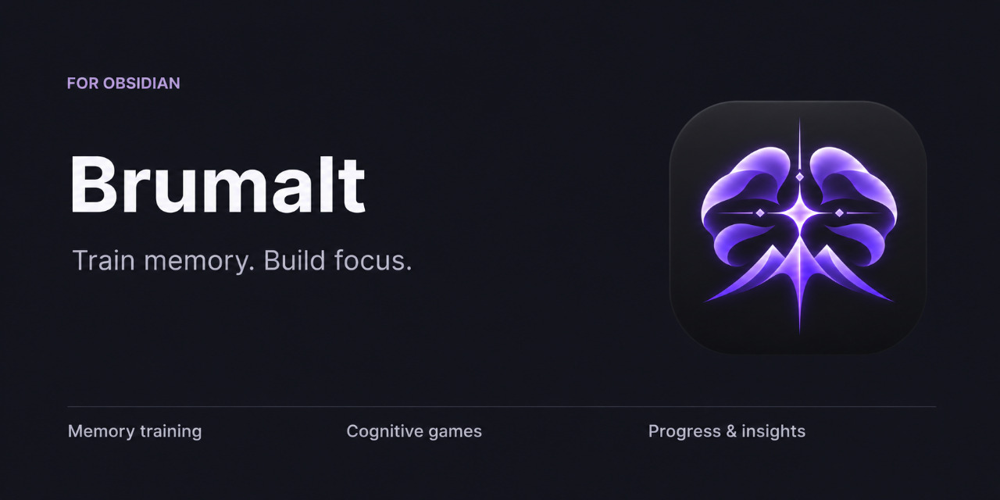

# Brumalt

Бесплатный офлайн-плагин для Obsidian: короткие игры на память и логику, адаптивная сложность, необязательная дневная цель и личная статистика.

**[English](README.md)** · [Скачать 0.3.4](https://github.com/zinverno/brumalt/releases/tag/0.3.4) · MIT · автор **Zinvernix**

- Шесть игр в компактном окне поверх текущей заметки.
- Сессии примерно на 1 / 3 / 5 минут или «Отдельная игра».
- Сложность для каждой игры, локальные результаты и игровой профиль.
- Необязательные цель и напоминания, без обязательных серий и наказаний за пропуски.
- Русский и английский. Без аккаунтов, рекламы, телеметрии, сетевых запросов и чтения заметок.

Это интеллектуальный досуг и практика конкретных упражнений, а не валидированный IQ-тест. Плагин не обещает научно доказанного роста общего интеллекта.

## Установка

Начните с пустого тестового хранилища. Требуется Obsidian **1.13.0+** для декларативных настроек с поиском. Запись совместимости версии 0.3.3 сохранена. Ограничения проверки нативной и мобильной версии: [VALIDATION](docs/VALIDATION.md).

1. Скачайте `brumalt-0.3.4.zip` из [GitHub Release](https://github.com/zinverno/brumalt/releases/tag/0.3.4).
2. Распакуйте единственную папку `brumalt` в `<хранилище>/.obsidian/plugins/` либо в свой каталог конфигурации Obsidian.
3. Внутри должны лежать `main.js`, `manifest.json`, `styles.css` и `LICENSE`.
4. Разрешите сторонние плагины и включите **Brumalt**.

В релизе также есть три установочных файла отдельно. `SHA256SUMS` проверяет ZIP и файлы после распаковки. В каталог Obsidian плагин пока не подан.

При последующих обновлениях **сохраняйте `brumalt/data.json` и его резервную копию**. Заменяйте только установочные файлы. Пользовательских данных в архиве нет.

### Переход с Casual Memory Games

ID меняется с `casual-memory-games` на **`brumalt`**:

1. Скопируйте старый `<config>/plugins/casual-memory-games/data.json` в безопасное место вне обеих папок плагина.
2. **Выключите Casual Memory Games.** Не запускайте оба плагина одновременно.
3. Установите и включите Brumalt в новой папке.
4. Если нового `brumalt/data.json` **ещё нет**, Brumalt проверит старый файл и однократно импортирует его до запуска игр и напоминаний. Уведомление подтвердит перенос.
5. Проверьте настройки, уровни, историю и дневную активность. Только затем решайте, нужна ли старая папка. Brumalt её не изменяет и не удаляет.

Используются публичные API Obsidian, включая ваш каталог конфигурации. Поддерживаются схемы данных версий 0.1.0–0.3.2. Перенос не создаёт новых попыток, не начисляет баллы заново и не применяет адаптацию повторно. После перезапуска читается новый файл.

**Любой существующий новый файл имеет приоритет**, даже пустой или повреждённый. Слияния историй нет. Ошибка чтения, схемы или записи блокирует игры и сохранение вместо тихого сброса. Старый файл остаётся нетронутым. Если ошибка импорта не создала новый файл, исправьте проблему диска и перезагрузите плагин. Если появился частичный новый файл, выключите Brumalt, сделайте его копию и проверьте. Перемещать его из папки для повторного импорта можно только когда в нём нет прогресса Brumalt, который требуется сохранить. Иначе восстановите проверенную резервную копию; не перезаписывайте историю ради запуска импорта.

Ручной вариант: при выключенных обоих плагинах сделайте резервные копии и скопируйте старый `data.json` в новую папку Brumalt, **только если там ещё нет файла данных**. При включении выполняется та же проверка схемы. Не объединяйте JSON вручную.

Локальный ID команды остаётся `open-games`, полный ID теперь **`brumalt:open-games`**. Горячую клавишу нужно назначить заново в Obsidian. Новые попытки Brumalt не переносятся обратно в старый плагин автоматически.

## Как играть

Значок на боковой панели или команда **«Открыть Brumalt»** → «Играть» → «Начать» → несколько попыток → «Вернуться к заметкам». Повторный вызов фокусирует то же окно.

Есть пять состояний: главная, прогресс, подготовка, игра и итог. Из прогресса и подготовки «Назад» возвращает на главную. В итоге доступны возврат к заметкам, новая игра и главная.

Остаётся только **нативный крестик Obsidian**, своего дублирующего крестика нет. Крестик, Escape и фон используют безопасный выход. При незавершённой попытке предлагаются отмена и «Остаться»: задание скрыто, таймеры приостановлены, введённый ответ сохраняется. Отмена и уход приложения в фон не считаются поражением. Запись завершённого результата продолжается после закрытия окна.

## Шесть игр

- **Числа:** запомните 4–13 цифр и введите их с клавиатуры или экранных кнопок. Начальные нули сохраняются.
- **Расположение:** запомните предметы на сетке и найдите нужный одним нажатием. От 3 предметов на 3×3 до 9 на 4×4.
- **Слова:** выберите 4–10 запомненных слов среди отвлекающих. До подтверждения выбор можно менять.
- **Последовательность:** повторите 3–12 подсветок плиток по порядку. Цвет дополнен символом, повторы видны отдельными импульсами.
- **Правило:** определите преобразование фигуры по примерам. Генератор проверяет однозначность в заданном классе правил.
- **Порядок:** используйте видимые условия для расстановки трёх или четырёх фигур. «Правее» и «сразу справа» различаются.

«Запомнил» досрочно скрывает числа, слова и расположение; иначе работает таймер. Последовательность проигрывается целиком. Логические условия остаются видны, ответ объясняется. Время ответа не ограничено, звука нет.

## Сессии и сложность

1 / 3 / 5 минут — приблизительные планы на 3 / 9 / 15 попыток. Минутная сессия использует одну игру; остальные — до трёх разных включённых игр, по возможности память и логику. Окончание — на границе попыток. До начала блока его можно заменить. Все игры доступны отдельно, даже если отключены в смешанных сессиях.

Длительность обновляется сразу без пересоздания экрана и сохраняется в фоне. Новый план использует выбранное значение; начатый план не меняется. Ошибка допускает повтор или возврат к сохранённому значению. Несохранённый выбор подчёркнут пунктиром; повторное нажатие повторяет запись, в том числе после закрытия окна.

Адаптация использует четыре завершённые попытки на текущем уровне отдельно для каждой игры. Для чисел, расположения и последовательности четыре результата ≥90% повышают уровень, три результата ≤50% понижают. Для слов повышение требует четырёх идеальных наборов, снижение — трёх попыток с минимум двумя неверными выборами; это достижимо на всех уровнях. Для логики — четыре верных или три неверных ответа.

За раз меняется один уровень и один параметр, окно очищается. Перед блоком можно задать новую отправную точку через «Полегче» / «Посложнее». В отдельной игре ручной уровень сохраняется до изменения. Запись уровня завершается до зависимого старта. Прерывания не влияют на адаптацию.

## Дневная цель и напоминания

По умолчанию — **6 баллов за местный календарный день**. В каждой игре первая сохранённая попытка даёт **2**, вторая **1**, последующие **0** баллов цели. Ошибочный ответ тоже считается участием; все завершённые попытки остаются в статистике. Прерывания и повторная запись того же ID не начисляют баллы. Одна игра даёт максимум три балла.

Можно выбрать 6 / 9 / 12 баллов или выключить цель. Новое число действует со следующего дня, отключение — сразу. Подпись «Сегодня: X / Y баллов» и неделя отделены от точности. Нет долгов, штрафов за пропуски или запрета играть дальше. Дата фиксируется при завершении; повтор сохранения после полуночи относится к исходному дню. Смена часового пояса не передвигает записанные дни.

Напоминания **по умолчанию выключены**. После первой сессии их можно включить небольшой строкой в итоге или позже в настройках. Начальное время — **18:00**. Не более одного напоминания внутри активного Obsidian за день, только при невыполненной цели и вне игры. Пропущенные прошлые дни не воспроизводятся. Это не системные уведомления; внешних задач нет. На значке есть спокойный индикатор незавершённой цели.

## Прогресс

Дневные баллы, неделя, лёгкая SVG-диаграмма и раскрываемая история. Рекорды сравниваются при одинаковых режиме, уровне, параметрах, правилах, способе окончания показа и языке слов.

Индекс оси — до десяти попыток при условиях последнего результата: `100 × (сумма точностей + 0,5 × (10 − число попыток)) / 10`, округлённый до пяти. Первая идеальная попытка даёт 55, десять — 100. Новая попытка при тех же условиях меняет индекс максимум на десять пунктов. При смене условий выбирается другая группа. Это игровой профиль, не измерение интеллекта.

Без попыток оценки нет. Для непрерывного контура используется только визуальная отметка **10/100**, полый маркер и подпись «Нет данных». В строке игры — прочерк. Реальный ноль остаётся нулём. Условная отметка не сохраняется и не влияет на баллы или адаптацию.

## Язык, данные и ограничения

Язык выбирается только в настройках: English, Русский, автоматически. Приоритет: настройка, язык Obsidian/среды, английский. У слов отдельные локальные словари и группы сравнения.

Brumalt читает собственные данные, а при первом импорте — файл прежнего плагина. Заметки не используются. Нет сетевых запросов, телеметрии или тяжёлого UI-фреймворка. Обложка показывается только в документации.

История ограничена **1000 попытками и 365 днями**, это не статистика за всё время. Неуспешно сохранённые результаты и настройки остаются только в памяти до успешной записи. Одновременные независимые записи/конфликты синхронизации не координируются. Сложность и индекс не проходили научной калибровки. Проверенные сценарии и ограничения нативной/мобильной проверки: [отчёт](docs/VALIDATION.md).

## Разработка

Node.js 22 или 24, npm; системные `zip` / `unzip` не нужны:

```sh
npm ci
npm run typecheck
npm test
npm run lint
npm run build
npm run verify-package
npm run dev
```

Готовые файлы: `dist/brumalt/`, архив `dist/brumalt-0.3.4.zip`, контрольные суммы `dist/SHA256SUMS`. CI проверяет обе версии Node в чистых slim-контейнерах без zip/unzip, включая официальный Obsidian ESLint. Архив создаётся fflate с фиксированным порядком и временем файлов, проверяется через Node; публикация предварительного релиза из main происходит только после проверок. Существующие опубликованные релизы не перезаписываются. Заявка в каталог Obsidian автоматически не отправляется.

[CHANGELOG](CHANGELOG.md) · [Описание релиза](docs/RELEASE-0.3.4.md) · [MIT License](LICENSE), © 2026 **Zinvernix**. Утверждённая обложка сохранена без изменений в `assets/walp.jpg`.
